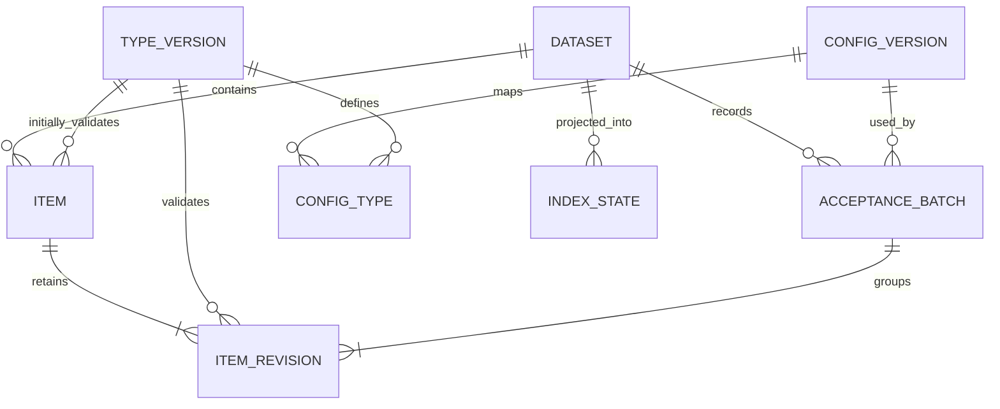

# Timeline architecture

This document describes how to implement the [Timeline system design](system-design.md). It is an implementation plan; no Timeline application exists yet.

Start at the [context entry point](README.md) for requirements and contributor guidance. Changes follow the [requirements-first workflow](engineering.md#requirements-before-code); the first code must satisfy the [engineering foundation](requirements/foundation.md).

## Boundary and data flow

Timeline is a standalone software project written in Go, with a command-line entry point named `tline`. It accepts a data root and item-type definitions without importing a consumer application. This repository contains Timeline's code, tests, documentation, and releases. The release distribution channel remains to be chosen.

Humans and agents primarily create and edit Markdown files using their preferred tools. They use `tline` to check those files, record accepted changes, and query the Timeline. They do not need to enter document content through CLI arguments. The CLI owns acceptance into the recorded Timeline; it does not need to own the editor.

```text
Humans and agents edit Markdown files
                  |
          tline check (validate and record)
                  |
   Accepted Markdown + type definitions + Git history
                  |
          Rebuildable database index
                  |
          tline list / history
```

Markdown files and preserved history are authoritative. The configured database is a rebuildable index, not another editable source. SQLite is the initial local backend. Direct file edits enter the same validation and indexing process as command-driven changes.

## CLI workflow

The initial CLI has three commands. These describe the planned interface, not installed software.

| Command | Purpose |
| --- | --- |
| `tline check [paths...]` | Recover the index if needed, validate changes, and automatically record them if all checks pass |
| `tline list` | List recorded items with date and metadata filters, file paths, and information about pending changes |
| `tline history <id>` | Show recorded revisions, including an item's moves and removal |

There are no separate init, accept, or rebuild commands. `check` creates local index storage when needed and handles recovery internally. Its help text must clearly state that a successful check records changes and may modify registration metadata and Git history.

Use `tline check --dry-run` to validate without changing files, Git history, or the persistent index. If recovery is needed, a dry run can inspect the authoritative records using temporary state and report what a normal check would do. It does not reserve an entry time or guarantee that a later check will pass.

Query and validation commands support readable terminal output and `--json` for agents. Define stable output fields and documented nonzero exit codes for validation failures, conflicts, incomplete results, and operational failures. Diagnostics identify the file, field or section, and reason. Report whether changes were recorded, whether nothing changed, or whether the operation was only a dry run.

For example, an agent writes `predictions/example.md`, then runs `tline check predictions/example.md`. If validation fails, it fixes the file and runs the command again. A human follows the same workflow using any Markdown editor.

New files may omit `id` and `entered_at`; a successful check assigns them when recording the item. Validate timing at registration, not against when the command started. Never backdate registration to a dry run, file timestamp, or date supplied in draft YAML. A future item that passes a dry run may fail later if its event time has passed.

With no paths, check all configured item folders. With paths, process only the selected changes, including removals and moves; moves must include both affected paths. Still validate dependencies such as duplicate IDs across the configured root. Record the selected set together only if all required checks pass. On validation failure, leave it unrecorded; repairing an index of previously recorded history is independent and may still succeed.

Direct edits remain pending until a successful normal check records them. Listing, reading history, recovering the index, or making an ordinary Git commit does not register pending changes.

## Root discovery and configuration

A tracked `timeline.yaml` marks the Timeline root and defines its item types, folders, fields, sections, allowed values, evidence requirements, and timing rules. Adding a type does not require changing application code. The precise configuration schema remains an implementation choice.

By default, search the current directory and then its parents, using the nearest `timeline.yaml`. Stop at that file and report any configuration errors rather than falling back to a different root. Resolve configured item folders relative to the Timeline root. Resolve CLI path arguments relative to the caller's working directory and reject targets outside the selected root or configured item scope.

For scripts and agents, allow an explicit root:

```sh
tline --root /path/to/my-project check
```

An explicit root requires `timeline.yaml` at that location; do not search elsewhere. Missing or invalid configuration produces an actionable error. Do not invent item types or silently create configuration. Recording changes requires a usable Git repository containing the root; report missing Git setup instead of silently initializing one.

## Implementation language and packaging

Use Go for the CLI and reusable core. It provides a straightforward path to a standalone executable and a future TUI while keeping Timeline independent of the language used by consumer applications or their agents.

Build platform-specific `tline` executables so users do not need Go installed to run a release. Use the installed Git executable for history operations; Git remains a runtime prerequisite. Keep dependencies modest and retain SQLite as the local, rebuildable index.

Choose the minimum Go version, SQLite driver, YAML library, and release tooling when implementation begins. Prefer a SQLite driver that does not require CGO to simplify cross-platform builds. Bubble Tea is a candidate for the later TUI, not a dependency required for the first CLI.

## Core and future interfaces

Implement validation, registration, history, indexing, and queries in a reusable core. The CLI parses arguments and presents results; it does not contain a separate implementation of the rules. A later `tline tui` can browse, edit, and run checks that record changes through the same core. It must not introduce another writable source of truth.

The first build needs the CLI and core. A TUI, file watcher, web service, and dedicated create/edit commands can be added when useful. On-demand scans are enough initially. Agent access does not require an MCP server.

## Package boundaries and dependency direction

Use one Go module initially. The planned layout is below; add packages only when their first requirement is implemented, not as empty scaffolding.

| Path | Responsibility |
| --- | --- |
| `cmd/tline/main.go` | Process entry, cancellation, dependency wiring, final exit |
| `internal/cli/` | Arguments, terminal/JSON rendering, exit-code mapping |
| `core/` | Reusable application use cases, domain values, validation, and narrow adapter contracts |
| `internal/config/` | Root discovery and configuration decoding |
| `internal/document/` | Markdown/YAML decoding and filesystem document operations |
| `internal/gitstore/` | Accepted Git history and publication/recovery adapter |
| `internal/index/sqlite/` | Initial SQLite adapter: queries, connection policy, generated SQL code, and migrations |
| `tests/integration/`, `tests/e2e/` | Cross-adapter and built-executable scenarios |
| `docs/requirements/` | Requirement index and focused acceptance criteria |

Keep `core/` importable so future consumers can reuse it; publishing a stable external library API is a separate release commitment. Adapters depend on core contracts, and the composition root supplies them. The core must not import CLI, concrete database drivers, or Git subprocess implementations. Small parsing/validation units may begin within `core/` and split when justified. Keep dependency direction acyclic; avoid a shared `utils` package that becomes an implicit dependency of everything.

Define domain results and error categories before parallel work. Interfaces belong to the use case consuming them and describe operations needed by requirements. Inject clocks and effects; pass cancellation explicitly. Each package documents ownership, invariants, and concurrency in `doc.go`. Follow the [parallel worktree workflow](engineering.md#parallel-agents-and-worktrees) and [performance requirements](performance.md) for implementation ownership and bounded runtime concurrency.

## Database selection and adapter contract

Follow [TL-DATABASE](requirements/TL-DATABASE.md): SQLite is the initial default, not a permanent core dependency. Users select a supported backend and target through configuration. The default remains `.tline/index.sqlite`; an explicit SQLite target may use another location. Additional engines require an implemented and verified adapter, not merely a different connection string. Do not build multiple backends in the first slice.

Define a small domain-oriented index contract in `core/`, covering the required recorded-state reads, queries, and atomic index updates. Keep backend initialization, migrations, dialects, generated types, pooling, and error translation inside adapters. The composition root validates configuration and selects the adapter. Avoid both leaked SQL details and a general-purpose database abstraction unrelated to Timeline's use cases.

Backend implementations must satisfy a shared real-database contract suite. Specify deterministic ordering, timestamp precision, metadata comparison/null behavior, and transaction visibility independently of SQL dialect before writing queries. Database-local schema versions belong to each adapter; accepted-history and configuration formats remain independent.

On a target change, reconstruct the new derived index from authoritative accepted history and then process pending changes through the normal workflow. Do not copy registration identity from unverifiable database rows, mutate the former target, or silently reuse a foreign dataset. Define dataset binding and namespace ownership before target reuse. Server credentials use environment references and must be redacted from output. Remote database support does not by itself provide shared filesystem/Git ownership or distributed acceptance.

## Data model

This is the logical model shared by all database backends. [TL-MODEL](requirements/TL-MODEL.md) defines its acceptance criteria. Entity and field names below describe the intended contracts; they are not yet a finalized YAML format, Go API, or SQL migration.

### Entities and ownership

| Entity | Identity and main fields | Meaning and authoritative evidence |
| --- | --- | --- |
| Timeline dataset | `dataset_id` | Logical dataset identity that survives a full clone and database replacement. Its durable encoding and clone/worktree binding must be specified before implementation; an absolute checkout path or database row ID is not sufficient. |
| Configuration version | `config_version_id`, `format_version`, configuration snapshot/reference, content hash | Immutable accepted configuration evidence preserved in Git. The snapshot must retain the definitions and validation-relevant settings used at acceptance, not just the current `timeline.yaml` path. Credentials are never stored in this evidence. |
| Type-definition version | `type_version_id`, configured `type_name`, complete definition, definition hash | Immutable validation rules: folder, metadata fields, required sections, allowed values, evidence requirements, timing rule, and Real-time delay. Configuration versions map type names to these versions. |
| Item | `(dataset_id, item_id)`, `entered_at`, `created_by`, initial type-version reference, first-revision reference | Stable identity and original registration facts established by first acceptance. Paths, current content, and current event time are not identity. The initial definition fixes original entry-timing classification. |
| Acceptance batch | `(dataset_id, acceptance_id)`, predecessor acceptance reference, `recorded_at`, actor, config-version reference, record-format version, Git publication association | One successfully recorded selected change set. It groups revisions so replay and indexing can detect incomplete application. Its durable record and referenced content live in preserved Git history. It is not an ordinary Git commit or an SQL transaction ID. |
| Item revision | `(dataset_id, revision_id)`, item reference, acceptance reference, previous-revision reference, change kind, old/new paths, content reference/hash, `timeline_at`, type-version reference, metadata | Immutable accepted state or removal for one item. Content references resolve to exact preserved Markdown bytes. The applied definition is the one used to validate this revision, not whatever definition is current during replay. |
| Working observation | root-relative path, observed hash/existence, claimed ID if readable, parsed draft values, diagnostics, scan context | Current filesystem evidence used to detect pending changes and conflicts. It may be invalid and may have no trustworthy ID. It is transient or disposable cached state, never a registration record. |
| Index state | dataset binding, backend schema version, indexed acceptance reference, projection-format version if needed | Derived checkpoint for the database projection. It proves only what the index has applied; it cannot establish missing accepted history. |

Actor and creator values are attribution labels, not authenticated accounts. No users table or account service is implied. Database-generated integer keys may be internal conveniences but must never become durable item, revision, or acceptance identity.

### Relationships



Each revision belongs to exactly one item and one acceptance batch. A batch contains at most one resulting revision per changed item. A move and edit in the same selected set therefore produce one revision with both paths and the new content. An item's first revision has no predecessor; later revisions identify the prior accepted revision. Acceptance ordering comes from validated history relationships, not timestamp sorting alone. Multiple records may share a timestamp.

The diagram shows item-changing batches. Whether configuration-only changes receive their own zero-item batch must be specified before configuration acceptance is implemented. Dataset and version references must be scoped consistently; a database must not join records from different datasets merely because their IDs or paths happen to match.

### Item state across revisions

A draft is a working observation, not an accepted item row. On first acceptance, the system assigns registration identity and time, preserves the exact recorded bytes, and creates the initial revision. Later edits are pending until another successful `check` adds a revision.

An update stores its accepted content and event time in a new revision. `entered_at` always comes from original registration. `recorded_at` belongs to the acceptance batch and says when this later revision was recorded. Event time, original entry time, and later revision time answer different questions and must not be collapsed into one timestamp.

A move preserves item identity and records old and new root-relative paths. A removal is a tombstone revision: it records the prior path and previous revision, with no new Markdown content. Earlier bytes remain reachable through history. The current projection has no live path for a removed item but retains its latest tombstone and prior revisions. Reuse of a vacated path must not merge unrelated item identities.

Ordinary updates remain validated against the original entry time and saved type definition. Merely changing today's configuration does not migrate existing items. Explicit type changes, definition migrations for existing items, and restoration of removed IDs require their own behavior and tests before being supported.

### Rebuildable relational projection

The initial SQLite adapter should represent these logical relations. Another adapter may use different physical tables or types but must pass the same domain contract tests.

| Logical relation | Key and relationships | Indexed data |
| --- | --- | --- |
| `datasets` | `dataset_id` | Validated dataset identity and binding evidence |
| `config_versions` | Dataset + config-version ID | Preserved configuration reference/hash and format version |
| `type_versions` | Dataset + type-version ID | Immutable complete type definition and timing rule |
| `config_types` | Dataset + config-version ID + type name | Mapping to type-version ID; permits unchanged definitions to be reused |
| `acceptances` | Dataset + acceptance ID | Predecessor, actor, recorded time, config version, Git association |
| `items` | Dataset + item ID | Original registration, initial type version, first/latest revision, derived live path/removal state |
| `item_revisions` | Dataset + revision ID; unique item per acceptance | Predecessor, paths, operation, accepted content reference/hash, event time, applied type version, parsed configured metadata |
| `index_state` | Dataset binding for the target projection | Last fully applied acceptance and projection/schema versions |

Foreign keys and uniqueness constraints enforce the relationships within the adapter. Live accepted paths must be unique within the dataset. A cached `items.latest_revision` must reference a revision of that same item. Tombstones never cascade-delete historical rows. Apply a batch's projection and checkpoint together in a database transaction so queries cannot observe half its indexed changes. This transaction does not make filesystem and Git publication atomic.

Keep authoritative Markdown bodies in preserved Git content. The database may cache bodies or parsed links when a measured query needs them, but these are not additional authoritative entities. Ordinary links and heading anchors remain in Markdown; a link table, automatic backlinks, and historical evidence pinning are not implied by this model.

Store configured metadata per revision in a validated typed representation. The initial physical choice between encoded values and normalized search rows remains to be settled with query requirements. It must preserve missing versus explicit null, scalar/list distinctions, and declared types; do not coerce every value to text. If current-value or metadata search tables are added, derive them from revisions and version their projection.

Candidate indexes follow actual query requirements: dataset plus event time and item ID for stable ordering, dataset plus entry time, item plus revision ordering, live path, type, and selected configured fields. Define comparison, collation, numeric, and timestamp semantics before backend-specific SQL. Avoid relying on a database's implicit row order or JSON coercion.

### Durable encoding decisions before code

The model above supplies relationships and invariants. The following must be resolved in this architecture before writing record codecs or the first SQL migration:

- ID generation/encoding, hash algorithms, content canonicalization rules, and timestamp precision.
- Dataset identity storage, clone/worktree behavior, and branch divergence/merge policy. The current model does not authorize silently linearizing conflicting acceptance histories.
- Acceptance-record location and format, reference resolution, the Git publication point, and crash recovery states. A record embedded in a commit cannot contain that same commit's hash; obtain the publication association from its containing commit or another explicitly defined non-circular mechanism.
- Configuration serialization and what constitutes a configuration-only acceptance; type-version identity and metadata/query semantics.
- Policies for explicit type changes and restoring removed identities if those features are included.

Exact original bytes, saved definitions, and acceptance relationships must be recoverable from durable history; a hash without recoverable content is insufficient. Missing or contradictory evidence is an error, not a reason to manufacture a new identity or registration time.

## SQL schema and migrations

The index schema is versioned from its first table. Place ordered immutable SQL migrations under `internal/index/<backend>/migrations/` and embed them into the executable. Assign one integration owner to migration numbering; use fixed-width versions so lexical and numeric ordering agree. Released migrations are never rewritten. Query SQL is source; if sqlc is selected, commit generated Go and check reproducible generation in CI. The [tooling comparison](tooling.md) recommends candidates without treating them as implemented.

Initialize an empty index and upgrade a supported older index automatically through normal index maintenance. Coordinate migrations with other processes before opening the schema for use, including processes already reading or writing the index. Specify the compatibility and coordination protocol before implementing migration concurrency. Run transactional migrations where supported and define a recoverable failure state otherwise. Unknown newer schemas must produce an actionable error; an older binary must not silently downgrade or delete them. Prefer forward fixes and reconstruction from complete accepted history over routine down migrations of a derived cache.

Keep index schema version, acceptance-record format version, and user configuration version distinct. SQL migrations never rewrite authoritative Markdown, configuration, or accepted Git history. Rebuilding an index requires the same historical evidence as ordinary recovery and must preserve registration identity. Dry runs use temporary state if migration/recovery is needed and never change the persistent index. Define accepted-history/configuration format evolution separately before changing those formats.

Test empty initialization, every supported upgrade, unknown versions, failure, simultaneous startup, migration with active readers/writers, and migrated-versus-rebuilt query equivalence. Runtime migration execution and generated query type checking are separate gates. See [testing](testing.md#sql-migration-verification).

## Data layout

The default layout is:

```text
my-project/
  timeline.yaml
  .tline/
    index.sqlite
  news/
  predictions/
  tasks/
```

The item folders above are examples configured by an application, not built-in types. Store the SQLite index at `.tline/index.sqlite` under the Timeline root. `tline check` creates this local storage automatically. Ignore `.tline/` in Git, including database sidecar files. Durable acceptance records must live in tracked history outside that ignored directory.

Each type definition selects a folder under the configured data root. Store one Markdown file per item in that folder. Keep source files, type definitions, and accepted revisions in Git. Keep database indexes and generated output outside tracked source files.

Type definitions declare a name, folder, required metadata and body structure, allowed statuses if any, evidence-reference requirements, and `entry_timing`: `past`, `future`, or `real_time`. A real-time definition also declares its maximum reporting delay. Do not build specific item names or statuses into the generic engine.

The exact type-definition schema remains an implementation choice. Preserve the complete definition used for accepted items so validation can be repeated after definitions change.

## Markdown format

An item has YAML frontmatter and a Markdown body. The shared metadata is:

| Field | Meaning |
| --- | --- |
| `id` | Unique item ID, preserved when a file moves |
| `type` | Configured type name |
| `timeline_at` | Event time |
| `entered_at` | System-recorded first registration time |
| `created_by` | Human or agent who added the item |

Types add their own fields and body sections. Long explanations and ordinary Markdown links belong in the body. Record the applied type-definition version and entry timing rule with the accepted revision so they survive an index rebuild.

Entry times are stamped at registration. A draft file cannot establish an earlier entry time by claiming one in YAML. Rebuilding already registered items restores their entry times from accepted history, rather than registering them again.

## Timing validation

Use timezone-aware timestamps, normalize comparisons to UTC, and use a controllable clock for tests. Let E be the event time and A the first entry time:

- `past`: E < A.
- `future`: E > A.
- `real_time`: 0 <= A - E <= the type's configured maximum reporting delay.

Define timestamp precision before enabling real-time types. An ongoing event can timestamp its current observation rather than its eventual completion. The type's declared rule determines validation; do not infer its rule solely from the dates. A recent Past item need not become Real-time.

Revalidate an existing item against its original entry time and saved type definition, not the current clock. Compute its current position relative to now separately. This allows a Future item to become overdue without losing its original classification.

## Writes and accepted history

Editors create or update working files. `tline check` validates the shared and type-specific fields, writes any assigned registration metadata, preserves the accepted revision, and refreshes the index. Check unique IDs, valid dates, configured statuses, and required body sections and references. Never change a status only in the index. `tline check --dry-run` does not alter source files, accepted history, registration times, or the persistent index. A check with no changes must not create another accepted revision.

Preserve who changed an item, when it changed, and its previous content. Save accepted revisions in Git before presenting them as registered history. Do not include unrelated working-tree changes in that record. Draft or invalid edits stay distinguishable from accepted content. A client's additional checks, such as preserving a forecast's original assessment rule, run before its changes are accepted.

Store an explicit acceptance record with the Git revision, including item IDs, content hashes, registration times, removals, applied type definitions, and the declared actor recording the change. This record must survive loss or replacement of the index database. Ordinary editor snapshots or unrelated Git commits are not acceptance records. Actor labels support local attribution; they are not authenticated identities. Domain checks configured by a client must run through the same acceptance path for direct file edits.

Serialize acceptance operations and compare file hashes before recording changes so a concurrent edit cannot be silently accepted as the content previously checked. Callers can supply the expected accepted revision and working-file hashes to reject stale operations. Use safe file replacement and make retries idempotent. Concrete locking and recovery details remain implementation work.

The CLI cannot recover a draft that one external editor overwrote before Timeline ever observed it. Humans and agents must coordinate edits to the same file or use editor conflict protection. Preserved accepted history protects recorded work; it does not make arbitrary filesystem writes conflict-free or protect against deliberate rewriting by someone controlling the repository.

## Indexing and recovery

A normal `tline check` automatically creates, repairs, or rebuilds a missing, damaged, or stale index from recorded documents, accepted Git history, and preserved type definitions. Restore previously registered items first, then validate and record pending changes. Recovery itself never assigns replacement IDs or new entry times to existing records.

On another machine, clone the repository with its full history, install `tline`, and run `tline check`. The ignored index is recreated locally. Copying only current Markdown, or omitting required history from a clone, is not sufficient to establish earlier registrations. If the required acceptance records cannot be recovered, report that limitation rather than silently treating existing records as new items. New drafts without registration claims can be registered normally.


The index tracks item ID, current path, type, dates, configured metadata, content hash, indexed revision, applied type-definition version, and validation state. It also indexes the historical revisions needed for past queries, including removed items.

A scan detects files added, changed, moved, or removed outside commands. Moving a file with the same ID updates its path; duplicate IDs are errors. A removed file remains available in history.

A file write and a database update are not one transaction. Record enough revision information to detect an interrupted index update and recover by rescanning. Rebuild the selected database index from the source documents, accepted history, and preserved type definitions. Never overwrite a newer file from a cached database row.

Expose invalid files, conflicts, and stale index entries to callers. A query that cannot reconcile relevant records must report that its result is incomplete or unavailable, rather than returning stale data as current or silently dropping errors.

Queries scan for relevant pending changes before presenting current results. They may show the last accepted content, but must label that content and report pending changes separately. A stale or incomplete result must be machine-readable as such; it must not look like an empty or successful complete query. Recovery from an accepted Git revision with a failed index update must reuse that registration, not create another one.

## Queries and links

Support date ordering and filters over shared and configured metadata. Return item paths so people and agents can open the Markdown. Applications can use status filters to find unfinished work or perform their own calculations.

Use relative Markdown links and optional heading anchors for document connections. Links to a current file resolve to current content. Applications that need exact historical evidence must retain the referenced revision or snapshot; a live link alone is not enough. Automatic backlinks and link repair remain deferred.

## Verification

Follow the [testing guide](testing.md) for unit, integration, executable E2E, race, fuzz, migration, and CI gates. Establish reproducible benchmarks and bounded concurrency as specified in [performance](performance.md). These engineering guides extend verification without replacing the product cases below.

Test configurable types without application-specific imports. Cover timing boundaries, exact timestamps, real-time delay limits, invalid metadata, type-definition changes, duplicate IDs, concurrent edits, repeated requests, interrupted indexing, file moves, and removals. Verify that rebuilding the index preserves entry times and historical query results.

Exercise the direct-edit workflow end to end: draft a file, dry-run it without recording it, run a normal check to record it, edit it again, and distinguish pending from recorded content. Test a prediction whose date passes between dry run and registration, fabricated entry times, all-or-nothing recording of selected changes, preservation of unrelated staged Git changes, and CLI JSON output and exit codes. Internal index recovery, dry runs, listing, and reading history must never register a pending edit.

Test root discovery from nested directories, nearest-config precedence, explicit roots, missing and invalid configuration, and path resolution. Verify that a full clone with no `.tline/` directory recovers the same IDs, entry times, and history. Cover damaged indexes, missing historical evidence, and repeated checks with no changes.

No hosted service, graph database, scheduler, or user-account system is required for the initial local implementation. Back up the source documents and their history; the index can be rebuilt.
